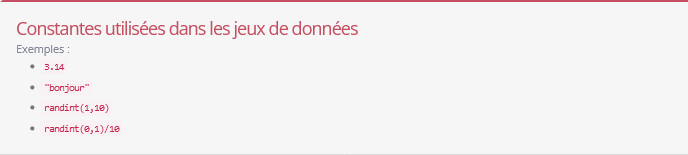
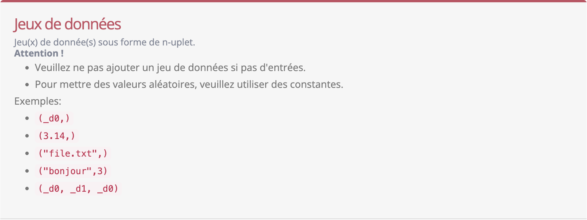
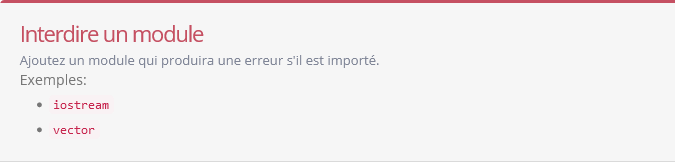
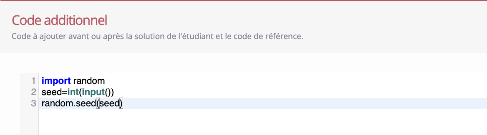

====================
Interface Professeur
====================

Navigation
----------

Le bandeau du haut permet d'avoir accès aux informations sur votre compte et aussi de vous déconnecter.

Le bandeau de gauche permet de naviguer entre les rubriques ci-dessous. Cliquer sur le symbole :math:`\equiv` permet d'en réduire sa taille ou de le remettre à sa taille initiale.

Accueil
-------

Donne les informations sur mes cours et les répertoires dont je suis éditeur ou importateur.

Mes cours
~~~~~~~~~

Donne la liste des cours que j'ai créé et les informations :

- Son ``Mnémonique``
- Son ``Titre``
- La date de ``dernière modification``
- Le ``Statut`` (ouvert ou fermé)
- Les actions possibles : édition ou visualisation du tableau de bord

Répertoires dont je suis l'éditeur
~~~~~~~~~~~~~~~~~~~~~~~~~~~~~~~~~~

Liste des répertoires d'exercice de professeurs que je peux éditer :

- Le ``Titre`` du répertoire
- La date de ``dernière modification``
- Les actions possibles : édition

Mon répertoire
--------------

Contient :

Éditeurs du répertoire
~~~~~~~~~~~~~~~~~~~~~~

La liste des autres professeurs à qui le Professeur a donné l'autorisation d'éditer son répertoire d'exercices.

Importateurs du répertoire
~~~~~~~~~~~~~~~~~~~~~~~~~~

La liste des autres professeurs à qui le Professeur a donné l'autorisation d'importer ses exercices.

Mes exercices
~~~~~~~~~~~~~

Liste des exercices créés par le Professeur (voir section :ref:`creation-edition-exercice`).

Marketplace d'exercices
-----------------------

Permet d'emprunter des exercices publics pour son ou un de ses cours.

Liens Utiles
------------

Accès aux `modes d'emploi ainsi qu'aux vidéo des tutos <https://upylab2.ulb.ac.be/records>`__.

Mon compte
----------

Donne les information sur votre compte :

- Prénom
- Nom
- Nom d'utilisateur
- Adresse email

Vous permet également de changer de mot de passe (cliquer sur ``Changer de mot de passe``).

Utilisation d'un cours par un étudiant
--------------------------------------

Voir le `Tutoriel sur liens utiles : Utilisation par un étudiant <https://www.youtube.com/watch?v=XFX5XjKKk_w&ab_channel=Upylab2>`__

Création et édition d'un cours
------------------------------

Pour créer un nouveau cours, dans l'accueil, cliquez sur le bouton ⊕ (``+`` cerclé) en haut à droite de la section cours.

Donnez un titre, cliquez sur le bouton ``créer`` ; ensuite :

- donnez sa description ;
- l'indication si le cours est ouvert (visible de tous les étudiants d'UpyLaB) ou fermé (accès sur invitation du professeur).

et n'oubliez pas de cliquer sur ``enregistrer``.

Ensuite, les boutons suivant sont utiles :

- Tableau de bord du cours
- Gestionnaire d'exercices
- Invitation
- LTI

Tableau de bord du cours
~~~~~~~~~~~~~~~~~~~~~~~~

Donne les informations sur le cours et les étudiants inscrits.

Gestionnaire d'exercices
~~~~~~~~~~~~~~~~~~~~~~~~

Permet de créer des chapitres et d'insérer des exercices au cours. Les exercices doivent avoir été créés auparavant et se trouvent dans le répertoire du professeur, ou le *MarketPlace* (dépôt des exercices publics dans UpyLaB).

Importer un exercice se fait via le bouton ``Importer un exercice``. Initialement mis dans le premier chapitre du cours, les exercices peuvent ensuite être déplacés dans le bon chapitre par *glisser déposer*.

Invitation
~~~~~~~~~~

Permet de générer un lien pour inviter un ou des étudiants à suivre le cours. Ceci est indispensable pour pouvoir inscrire des étudiants à un cours privé (non ouvert).

LTI
~~~

Permet d'avoir l'intitulé LTI, la clé et le secret pour connecter le cours via le protocole LTI (par exemple pour intégrer des exercices UpyLaB à un cours sur Moodle ou EdX).

.. _creation-edition-exercice:

Création et édition d'un exercice
---------------------------------

Dans mon répertoire, cliquez sur le bouton ``Créer un exercice``. Donnez ou déterminez :

- un titre et cliquez sur le bouton ``Créer`` ;
- l'énoncé (via l'éditeur ou en donnant le code html source) ;
- les éventuels conseils. Les conseils (qui peut inclure une solution type, ...) ne sont débloqués et affichés que lorsque l'etudiant réussit l'exercice ;
- les thèmes (étiquettes donnant les compétences sur lequel l'exercice travaille) ;
- si l'exercice est public ;
- le code de référence qui sera utilisé pour comparer avec le code de l'étudiant.

Ensuite déterminez quel type de test sera réalisé :

- Entrées/sorties (I/O)
- Sur la valeur de variables
- Sur le retour (et éventuellement les valeurs des arguments après appels) suite à un appel à une fonction.

Ensuite cliquez sur ``Suivant``.

Choix des fichiers
~~~~~~~~~~~~~~~~~~

Quel que soit le type de test demandé, vous avez la possibilité d'inclure des fichiers qui seront accessibles dans le répertoire de travail où le test s'exécute.

**Important :** lors de l'édition d'un test comportant des fichiers, ceux-ci ne sont pas inclus dans la configuration pour des raisons de sécurité. Pour modifier le test, vous devez soit re-télécharger les fichiers afin de les inclure à nouveau (via les liens de l'énoncé), soit éditer directement le JSON du test dans la section en dessous.

Définition de constantes
~~~~~~~~~~~~~~~~~~~~~~~~

Vous pouvez ensuite définir des constantes qui, pour les tests seront dénotées ``_d0``, ``_d1``, ``_d2``, ...

Ces constantes peuvent être des valeurs (de type int, float, str, tuple, list, ...) ou des expressions Python incluant ou non des valeurs aléatoires utilisant randint ou sample (voir ci-dessous).

Exemples de définition de constantes avancés utilisant de l'aléatoire

- ``sample(([i for i in range(1,10)]*100), k=10)[:randint(5,10)]``
- ``“‘’.join([‘abcd’[randint(0,3)],‘abcd’[randint(0,3)],‘abcd’[randint(0,3)],‘abcd’[randint(0,3)]])”``
- ``tuple([randint(1,10), randint(1,10), randint(1,10), randint(1,10), randint(1,10), randint(1,10), randint(1,10)][:randint(1,7)])+(-1,)``

Le dernier exemple donne un tuple de longueur entre 1 et 7 d'entiers entre 1 et 10, terminé par la valeur -1

Jeux de données
~~~~~~~~~~~~~~~

Ensuite vous définissez des tuples donnant soit les séquences qui seront lues en entrées par le code, soit envoyées comme arguments à la fonction à tester (pour les tests de fonction).

**Attention** : si le code n'a qu'une seule entrée ou la fonction un seul argument ``x``, le tuple vaudra ``(x,)`` (n'oubliez pas la virgule).

Vous pouvez ensuite déterminer le paramètre ``Mélanger`` déterminant si vous désirez mélanger les jeux de données (ordre aléatoire).

Interdire un module
~~~~~~~~~~~~~~~~~~~

Il est possible d'interdire l'utilisation d'un ou plusieurs modules lors de l'exécution du test. Si l'un de ces modules est importé, une exception sera levée pour un test python.

Pour un test C, la compilation du code produira une erreur.

Par exemple pour un exercice qui demande de reecrire la fonction sinus en python, on peut interdire le module "math".

Autoriser les erreurs (uniquement en python)
~~~~~~~~~~~~~~~~~~~~~~~~~~~~~~~~~~~~~~~~~~~~

Vous pouvez décider si vous souhaitez autoriser les erreurs via le paramètre ``Erreur``. Si ce paramètre est activé, en cas d'erreur, le test comparera les erreurs entre le professeur et l'étudiant. Si l'erreur est strictement identique, alors le code sera considéré comme valide. Si l'option n'est pas active, toute erreur rate automatiquement le test.

Interdire les leaks (uniquement en C)
~~~~~~~~~~~~~~~~~~~~~~~~~~~~~~~~~~~~~

Vous pouvez décider si vous souhaitez interdire les fuites mémoires via le paramètre ``Leaks``. Si l'option est activée, aucune fuite mémoire n'est autorisée au sein du programme, si une survient le test échoue.

Ajouter un code supplémentaire
~~~~~~~~~~~~~~~~~~~~~~~~~~~~~~

Il est également possible d'inclure du code supplémentaire, avant ou après le code de référence/étudiant, en fonction du paramètre ``Append``. Par exemple : ``import random\nrandom.seed(int(input()))`` peut être ajouté avant le code afin d'obtenir les mêmes entrées dans le code étudiant et professeur avec le module random.

Tests Entrées/sorties (I/O)
~~~~~~~~~~~~~~~~~~~~~~~~~~~

Vous devez donner ou préciser :

- si la sortie est une seule et unique valeur de type ``float`` (pour faire des tests d'égalité modulo epsilon = :math:`10^{-5}`)
- si les tests sur les sorties sont strictes ou robustes aux espaces; dans ce cas un ou plusieurs espaces ou tabulations sont équivalentes.

Ensuite cliquez sur ``Générer la configuration`` de test.

Vous pouvez ensuite tester le code (au départ par rapport à lui même) et quand la génération de tests est satisfaisante, cliquez sur ``Enregistrer les changements``.

Test sur des variables (uniquement en python)
~~~~~~~~~~~~~~~~~~~~~~~~~~~~~~~~~~~~~~~~~~~~~

Ici UpyLaB va comparer à la fin des exécutions, la valeur de variables du code de référence avec celles du code de l'étudiant.

Vous devez donner ou préciser :

- les variables à tester (valeur des variables en fin d'exécution).

Ensuite cliquez sur ``Générer la configuration`` de test.

Vous pouvez ensuite tester le code (au départ par rapport à lui même) et quand la génération de tests est satisfaisante, cliquez sur ``Enregistrer les changements``.

**Notes sur test de variables**

Pour des classes prédéfinies, UpyLaB teste si les structures sont les mêmes avec une tolérance de :math:`10^{-5}` pour les valeurs de type ``float``. Pour des variables utilisant des classes définies par l'utilisateur, les attributs de données publiques sont testées (nom et valeur identiques). Si un attribut public est une fonction ou une méthode, les tests se limitent au nom de l'attribut.

Notons que, contrairement à la plupart des testeurs qui utilisent des ``assert`` et l'opérateur ``==``, pour UpyLaB la matrice 3x3 nulle ``[[0]*3 for _ in range(3)]`` n'est pas équivalente à ``[[0]*3]*3`` (qui n'est pas du tout une matrice 3x3. (Notons que malheureusement ``[[0]*3 for _ in range(3)] == [[0]*3]*3``).

UpyLaB peut tester des données structurées utilisant des classes définies (par exemple, listes chaînées, arbres, ...). Voir :ref:`exemple plus bas <exemple-avance>`.

Test de fonction
~~~~~~~~~~~~~~~~

Ici UpyLaB va comparer les résultats et éventuellement les arguments après l'exécution d'une fonction (comparaison du code de référence avec le code de l'étudiant).

**Important :** uniquement le code de la fonction est testée, les variables globales ne sont donc pas accessibles.

Vous devez donner ou préciser :

- Le nom de la fonction
- arité de la fonction (le nombre de paramètres) en python ou la signature de la fonction en C
- si vous désirez qu'UpyLaB teste la valeur des arguments au retour de l'exécution de la fonction (uniquement en python)

Ensuite cliquez sur ``Générer la configuration`` de test.

Vous pouvez ensuite tester le code (au départ par rapport à lui même) et quand la génération de tests est satisfaisante, cliquez sur ``Enregistrer les changements``.

Aide
----

Forum UpyLaB : Voir `le forum NSI le-juge-en-ligne-et-environnement-upylab <https://mooc-forums.inria.fr/moocnsi/>`__

ou dans la `FAQ du MOOC "Apprendre à coder avec Python" <https://upylab2.ulb.ac.be/pub/FAQ_mooc>`__ (Attention certaines parties de la FAQ sont propres au MOOC).

Voir aussi `Tutoriel sur liens utiles : Création d'un cours pour le professeur <https://upylab2.ulb.ac.be/records>`__

Ces vidéos ne couvrent pas toutes les options disponibles dans la version actuelle d'Upylab, mais elles restent utiles pour la création de cours.

.. _exemple-avance:

Exemple avancé : définition et test de nouvelles classes
--------------------------------------------------------

L'exemple suivant donne le code de référence qui définit et teste l'utilisation d'arbres binaires (classe ``Arbre``).

Les tests se feront sur les variables ``x``, ``y``, ``res`` et ``res2``.

.. code-block:: python

   class Arbre(object):
       """definition de la classe arbre"""
       def __init__(self, val=0, fg=None, fd=None):
           '''méthode init'''
           self.val = val
           self.fg = fg
           self.fd = fd
       def __repr__(self):
           return 'Arbre<'+ repr(self.val) + (', '+repr(self.fg) if type(self.fg) is Arbre else "")\
               + (', ' + repr(self.fd) if type(self.fd) is Arbre else "") + '>'

   def const(a):
       return Arbre(*[const(e) if type(e) is list else e for e in a])

   #-main-#

   x =int(input())
   res = const([x])
   y = eval(input())
   res2 = const(y)

Notez que la méthode ``__repr__`` sert au bon affichage des résultats par UpyLaB.

Par exemple avec les entrées ``152`` et ``[1,[2,[3]]])``, on obtient le résultat :

.. code-block:: text

   Variables(s) après l'exécution :
     res = Arbre<152>
     res2 = Arbre<1, Arbre<2, Arbre<3>>>
     x = 152
     y = [1, [2, [3]]]
